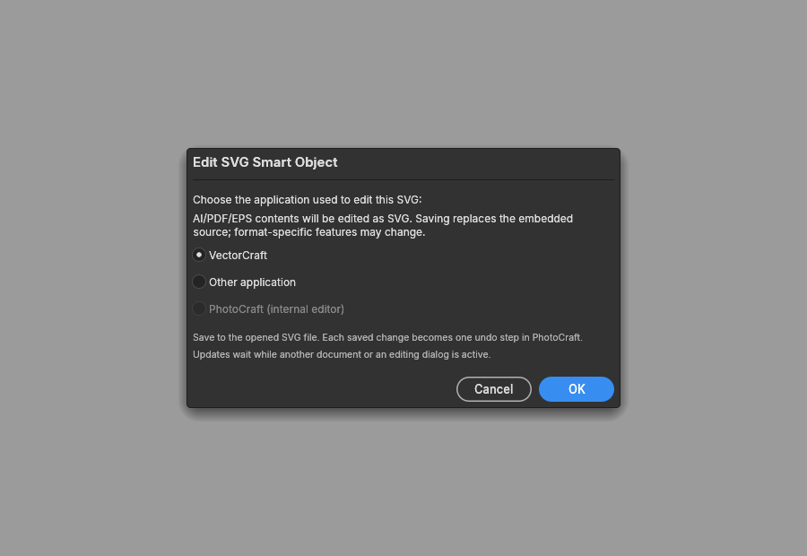

# Embedded vector smart-object editing

Layer > Smart Objects > Edit Contents offers VectorCraft editing for embedded SVG,
PDF-compatible AI, PDF and EPS, including payloads retained in PSD linked-layer tables.
Choose VectorCraft or a local executable. PhotoCraft creates a private SVG working copy;
saving that file updates the original smart object when its parent is active and ready.
Each accepted save is one undo step, including all shared instances. Placement, masks,
filters and Undo/Redo remain in the existing smart-object transaction.

For a vector inside a nested PSB smart object, save the edited PSB contents back to its
parent as well. Raster/PSD/PSB internal editing retains its existing behavior.

## Format and platform limits

The chooser warns that the first accepted save replaces native AI/PDF/EPS bytes with SVG.
Format-specific effects and missing fonts can change appearance. This is not lossless
native AI/EPS editing. Test on a PSD copy. Original embedded bytes stay intact until a
valid changed save, and Undo restores them. No original file on disk is edited.

AI/PDF/EPS conversion requires vectorcraft-cli beside the selected VectorCraft executable.
It runs headless in the background, restricted to a private temporary read/write root.
Both open and export must succeed. Conversion has cancellation and a 60-second timeout.
The PSD source-pixel frame is retained when PDF points differ from stored dimensions.
Unsupported frames fail without changing the smart object.

Desktop integration supports an explicitly selected executable. Linux discovery checks
standard native locations and a user Flatpak deployment. On Linux, choosing VectorCraft
uses the desktop's Open With chooser to launch the regular application;
select VectorCraft there. The writable document portal shares only the private working
SVG. Working copies live in PhotoCraft's private cache because its isolated /tmp cannot
be exported. Ordinary VectorCraft launches retain preferences and existing-window
handoff instead of running a second payload inside PhotoCraft's sandbox. Reusing tabs
requires the installed VectorCraft build's Linux single-instance support.

Native AI/PDF/EPS conversion still needs vectorcraft-cli alongside the discovered
executable. The tested local PhotoCraft package has read-only access to that deployment;
this source change adds no broad filesystem or host-process permissions. SVG editing
through the portal does not require access to the VectorCraft deployment. Explicit
Other application executables retain their direct-launch behavior. Windows and macOS
runtime acceptance has not been performed. Browser and automation paths do not launch
editors; browser internal editing remains available.

This PR does not add clipboard discovery or Paste As. It stands alone on main, without
requiring the clipboard or Shape Tools work in #3409/#3446. Its source-watching and
bounded SVG rendering build on credited open-source work from #3409; the embedded
AI/PDF/EPS extension was first submitted in Skyfuller1303/photocraft#1.

## Safety

Artwork never supplies a program, command line or output pathname. Editor selection is
explicit, without a shell. The interactive editor runs with its normal desktop permissions;
the restricted MCP roots apply to conversion, not to that editor process.
Working copies reject links and nonregular files; Unix opens
are no-follow and nonblocking. Unix save settling includes device/inode identity, including equal-time atomic replacement.
Reads remain byte-bounded even if another process grows the file.

Source input/output is limited to 16 MiB. Bounded SVG parsing limits decoded embedded
images, nesting and aggregate render/cache pixels to 24 million. External file and URL
images are not fetched. Missing system generic fonts fall back to installed families;
matching typography still requires the authored fonts.

Memory-only layer.smartObjects.exportSvg and layer.smartObjects.updateSvg validate
parent document, layer, shared-content identity and source fingerprint. They never
follow a linked disk pathname or launch processes. Automation authorization also checks
visible stored smart filters on every shared instance before replay, so a desktop LUT
file parameter cannot inherit filesystem access. Malformed saves, locked targets and
conflicting edits retain existing content. Saved updates wait through masks, gradients,
other active previews and dialogs instead of interrupting an edit.

## Validation evidence

Eight contributor-owned logo PSDs were tested through their visible nested AI vectors.
A real VectorCraft edit/save reached PhotoCraft's native watcher and engine; child and
parent Undo/Redo and PSD export/reopen preserved the changed vector. Original SHA256
hashes were unchanged. This combines runtime editor/engine acceptance and separate UI
wiring tests; it is not a claim of manual full PhotoCraft GUI acceptance. Private artwork,
screenshots and the acceptance harness are excluded from this repository.

Linux Flatpak GUI acceptance also verified an editor save through the writable document
portal reached PhotoCraft's watcher, with an ordinary document opening as a second tab
in the same VectorCraft window. Both launch orders were checked.

D-Bus tests cover
chooser success/cancellation/failure and reject symlinks and FIFOs before sharing.

Offscreen dialog capture with authored bytes and mock services; no private artwork.
